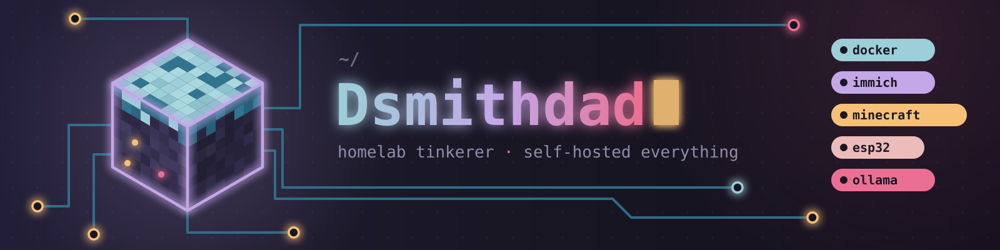

  

  
  
  

### 👋 Hey, I'm a dad who builds things

I run a homelab out of my house and self-host as much as I can: photos, dashboards, game servers, smart home and local AI.
I'm learning as I go and pairing with Claude Code, and when something turns out well, I clean it up and share it here.

### 🧊 Projects

| Project | What it does |
|---|---|
| [**homelab-dashboard**](https://github.com/Dsmithdad/homelab-dashboard) | Self-hosted homelab dashboard: FastAPI + React, 14 themes, local AI chat with voice, Docker / GPU / drive health tiles |
| [**immich-family-frame**](https://github.com/Dsmithdad/immich-family-frame) | Hourly-rotating digital photo frame for Immich: clear photos of the people you choose, on any tablet, iPad, Pi or TV |

### 🛠️ Stack

  
  
  
  
  
  
  
  
  
  
  
  

### 🔧 On the workbench

- 📱 An Android kiosk app that turns old tablets into always-on photo frames
- 🔌 ESP32 tinkering: sensors, screens and whatever else is in the parts drawer
- 🧠 More local AI on the home server

~/ built on a homelab, one container at a time

